<div align="center">

# Bitácora de buceo

**Mi diario de buceo como un descenso en 3D: haces scroll y bajas.**

Cada inmersión con su perfil real (registrado con Pro Dive en un Apple Watch Ultra 2), las cifras, los sitios, las titulaciones y un álbum de cromos con las especies que voy encontrando.

[**bitacora-aitor.vercel.app**](https://bitacora-aitor.vercel.app) · [Álbum de especies](https://bitacora-aitor.vercel.app/album)

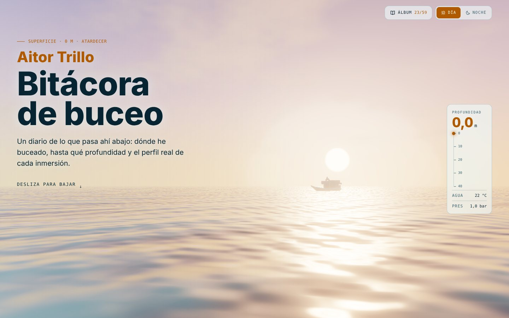

</div>

## Qué hay

- **Un descenso que se controla con el scroll.** La página es una columna de agua: empiezas en la superficie y bajas hasta los 40 m. Un profundímetro marca la profundidad, la temperatura y la presión, y la luz, el color del agua y la fauna cambian con la profundidad.
- **Día y noche.** De noche el agua es negra, brilla el plancton y el submarinista enciende su linterna.
- **El tiempo cambia en cada visita:** despejado, lluvia, tormenta con mar encrespado y relámpagos, niebla, y atardecer o lluvia de estrellas según el modo.
- **Cifras y récords** sumados inmersión a inmersión, con el reloj en 3D que las registra.
- **Mapa** con la costa dibujada en SVG (sin servicios de mapas): cuanto más grande el punto, más inmersiones ahí.
- **Perfil de cada inmersión**, con la parada de seguridad, los datos del reloj y las notas.
- **Álbum de especies:** 59 especies que se pueden ver buceando en España, como cromos 3D low poly. Las que no he visto salen en silueta, el marco dice lo difícil que es verlas y cada ficha tiene un mapa de calor de dónde es más fácil encontrarlas.
- **Panel privado** para subir las inmersiones (.uddf), editar las notas, decidir qué cuenta en las estadísticas, marcar especies, ajustar el tiempo y descargar copias de seguridad.

<table>
  <tr>
    <td width="50%">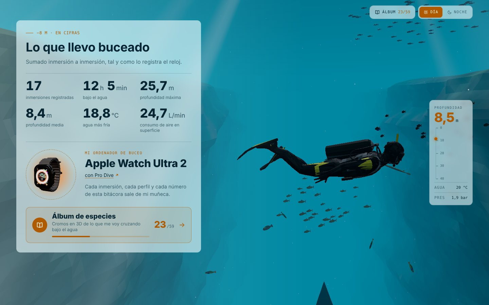</td>
    <td width="50%">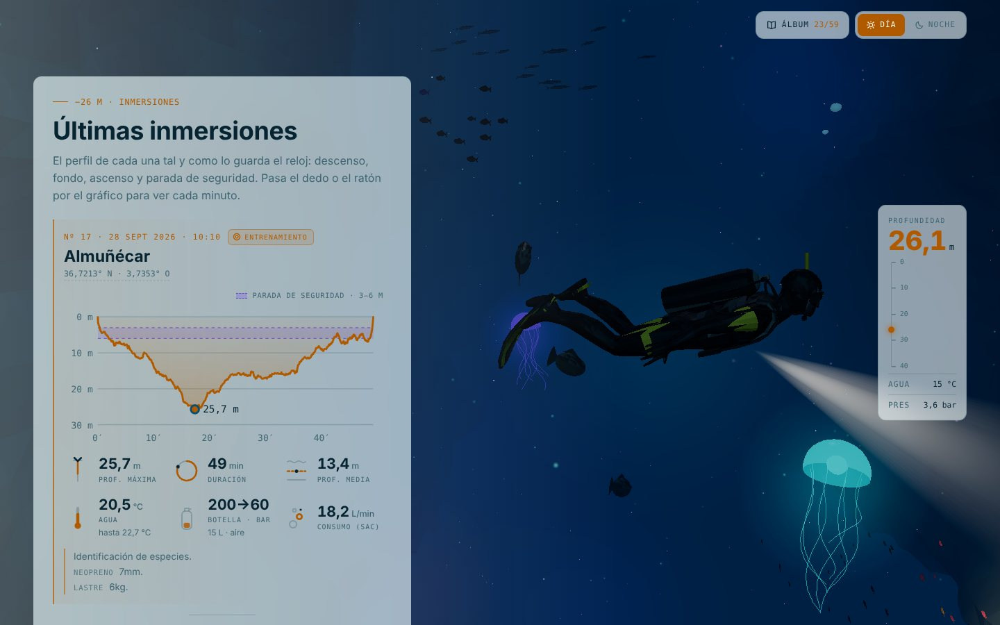</td>
  </tr>
  <tr>
    <td>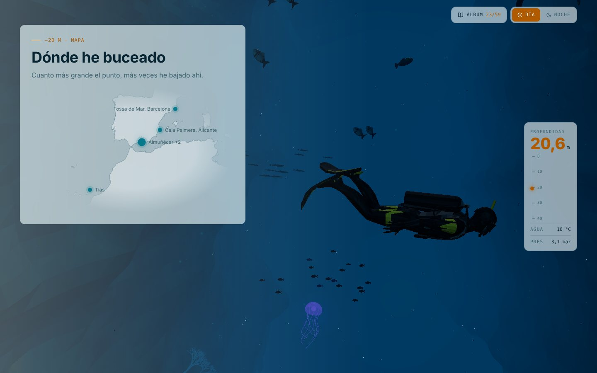</td>
    <td>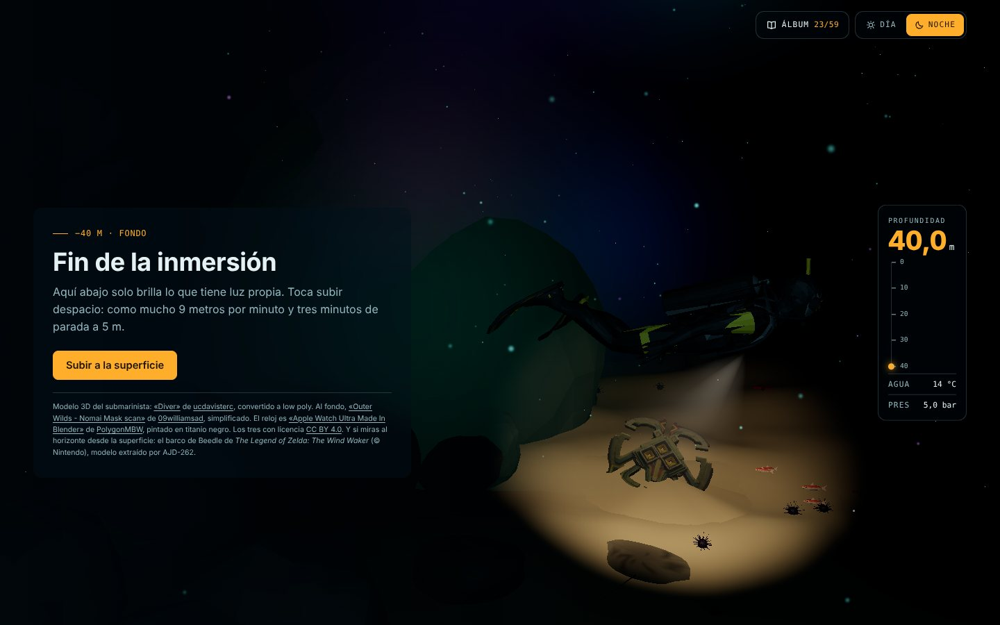</td>
  </tr>
</table>

### El tiempo en la superficie

<table>
  <tr>
    <td width="50%">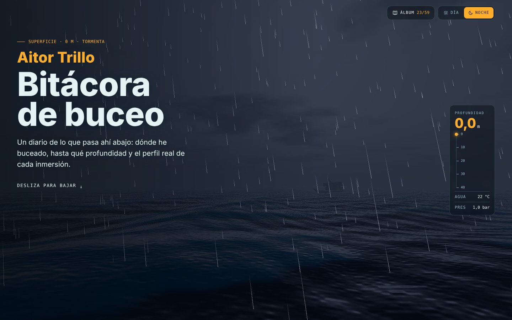</td>
    <td width="50%">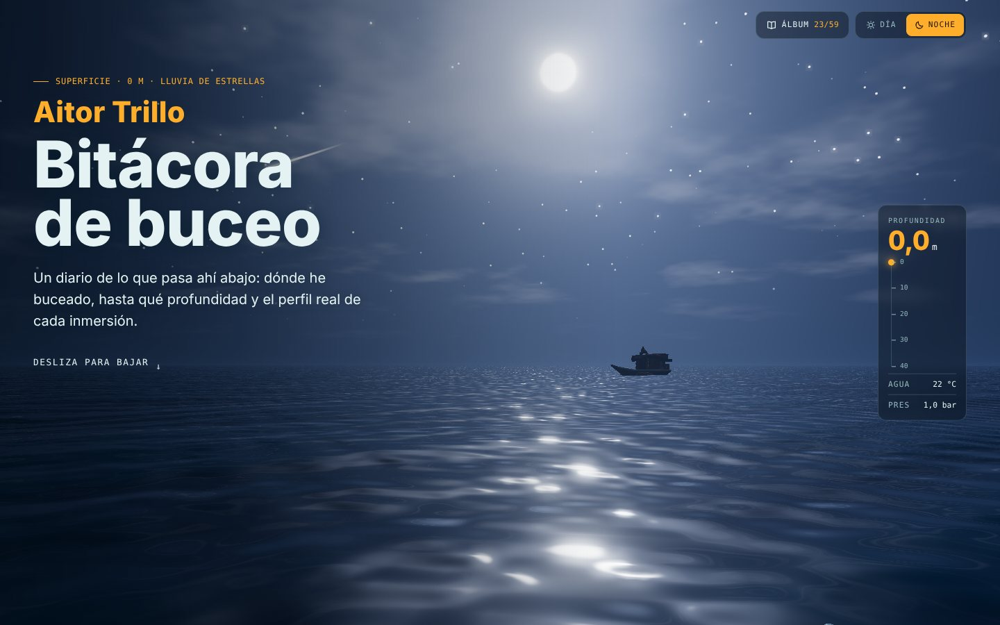</td>
  </tr>
</table>

### Álbum de especies

<table>
  <tr>
    <td width="50%">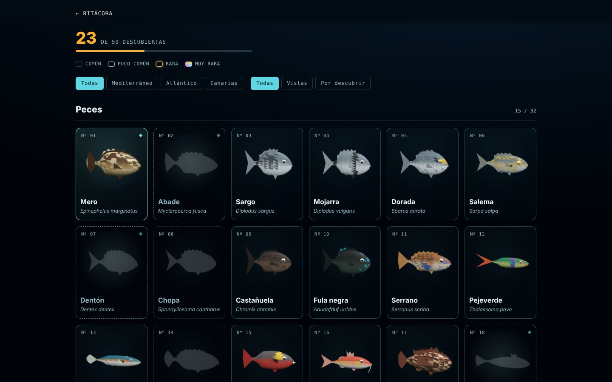</td>
    <td width="50%">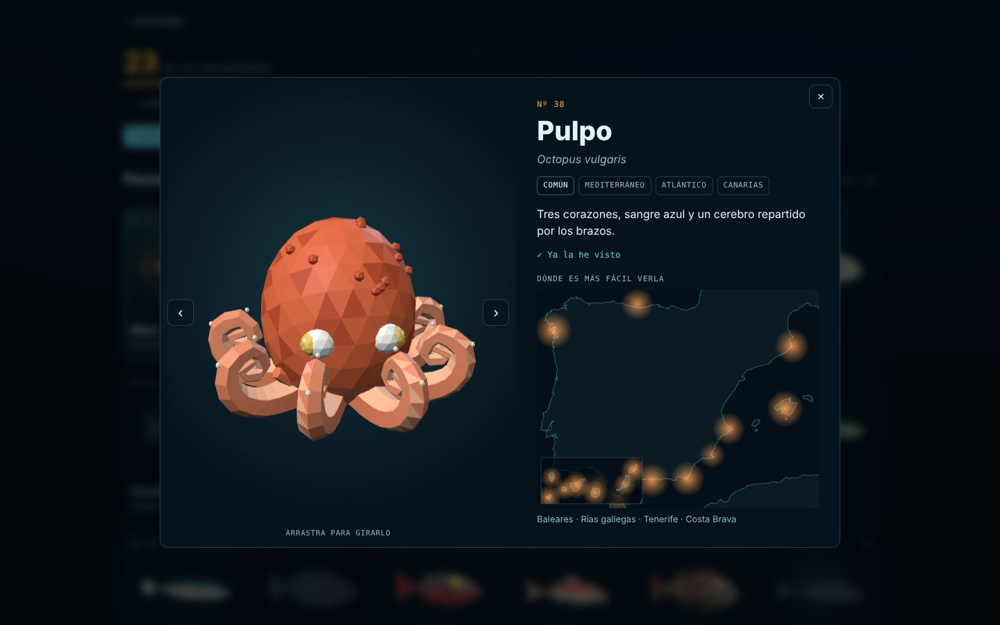</td>
  </tr>
</table>

### En el móvil

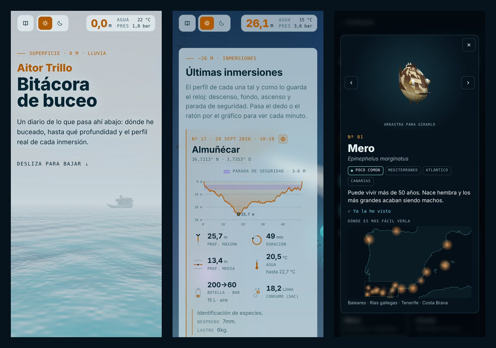

### Panel privado

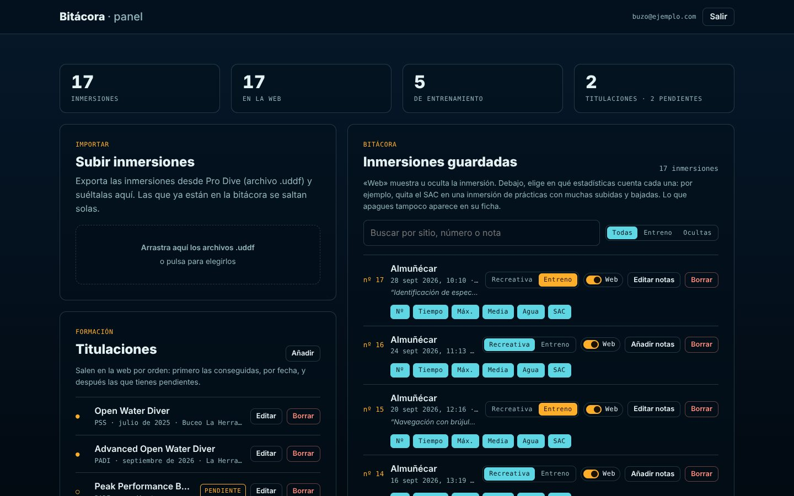

<sub>Las capturas se han hecho en local con datos de ejemplo.</sub>

## Cómo está hecho

| | |
|---|---|
| **Web** | [Vite](https://vitejs.dev), HTML, CSS y JavaScript sin framework |
| **3D** | [three.js](https://threejs.org): cielo, mar y tiempo con shaders propios, bloom, fauna procedural y modelos glTF comprimidos con meshopt |
| **Datos** | [Supabase](https://supabase.com) (Postgres + autenticación) con reglas de acceso por fila |
| **Alojamiento** | [Vercel](https://vercel.com): despliegue en cada push, una tarea diaria para que Supabase no se pause y Web Analytics sin cookies |
| **Inmersiones** | Exportaciones UDDF de Pro Dive, leídas en el navegador |

**Rendimiento:** el texto se pinta antes que nada; la escena 3D llega después, compila sus shaders sin congelar la página donde el navegador lo permite y hace un pase de calentamiento invisible para que nada se compile a mitad del descenso. Va a 60 fotogramas estables (también en pantallas de 120/144 Hz) y baja la resolución sola si un equipo no llega. Los modelos van comprimidos con meshopt; el reloj y la máscara del fondo se preparan en el primer momento en que la página está quieta. La portada lee los datos con `fetch` directo a la API de Supabase, sin la librería completa.

Las figuras del álbum no son modelos descargados: cada especie se genera en código a partir de unos pocos parámetros (forma, colores, aletas, dibujo) en `src/album/models.js`.

## Puesta en marcha

```bash
npm install
npm run dev       # http://localhost:5173
npm run build     # genera dist/
npm run preview   # sirve dist/ en local
```

Sin Supabase configurado, la web usa la copia local de `src/data/dives.json`. También se puede importar desde la terminal a esa copia:

```bash
npm run import -- ~/Downloads/ProDive_16_2026-09-13_1010.uddf
```

### Supabase (una sola vez)

1. Crea un proyecto en [supabase.com](https://supabase.com).
2. En **SQL Editor**, ejecuta `supabase/schema.sql` y después, por orden, las migraciones de `supabase/migrations/` (002 a 005).
3. En **Authentication → Users → Add user**, crea tu usuario (marca *Auto Confirm User*).
4. Hazlo administrador en el SQL Editor: `insert into public.admins (user_id) select id from auth.users where email = 'tu@email.com';`
5. En **Authentication → Sign In / Providers**, desactiva *Allow new users to sign up*.
6. Pon la URL del proyecto y la clave **publicable** en `.env` (o en `.env.local` para probar otro proyecto; ese no se sube).

## Seguridad

- En el repositorio solo hay claves públicas: la URL de Supabase y la clave publicable (`sb_publishable_…`), que van en la web de todas formas. La clave secreta no se usa en ningún sitio.
- Lo que puede hacer cada uno lo deciden las reglas de acceso por fila (`supabase/schema.sql` y migraciones): cualquiera puede leer lo que sale en la web; solo los usuarios de la tabla `admins` pueden escribir. Las inmersiones ocultas no se pueden leer desde fuera (migración 005).
- Los registros están cerrados: el único usuario es el administrador.
- Todo lo que viene de la base de datos se escapa antes de pintarse en la página.
- Vercel añade cabeceras de seguridad (`vercel.json`) y el panel no se indexa (`robots.txt` y `noindex`).
- La tarea diaria (`api/keepalive.js`) solo lee una fila y, si se define `CRON_SECRET` en Vercel, solo la puede lanzar Vercel.
- El panel puede descargar una copia de seguridad completa en JSON y restaurarla.

## Estructura

```
index.html, src/main.js     portada: secciones, cifras, perfiles, profundímetro y scroll
src/scene.js                escena 3D: cielo, mar, tiempo, arrecife, submarinista y su luz
src/weather.js              sorteo del tiempo y ajustes que llegan del panel
src/fauna.js, src/diver.js  peces y animación del submarinista
src/watch.js                el Apple Watch que gira en «Lo que llevo buceado»
src/map.js, src/data/       mapa en SVG (costa ya proyectada) y copia local de las inmersiones
src/lib/                    lector UDDF, estadísticas y cliente de Supabase
album.html, src/album/      álbum: catálogo, generadores de figuras y componente (rejilla, ficha, mapa)
admin.html, src/admin.*     panel privado
404.html, src/notfound.*    página de error
api/keepalive.js            ping diario a Supabase (Vercel Cron)
supabase/                   tablas, reglas de acceso y migraciones
scripts/                    importador UDDF, conversores de modelos y generador de la costa
public/                     modelos glTF, iconos, tarjeta para compartir y robots.txt
docs/screenshots/           capturas de este README
```

## Easter eggs

- Desde la superficie, mirando al horizonte, flota el barco tienda de Beedle (*The Legend of Zelda: The Wind Waker*).
- Al llegar al fondo, la linterna se posa sobre una máscara nomai de *Outer Wilds* medio enterrada en la arena.

## Créditos

- Submarinista: [«Diver»](https://sketchfab.com/3d-models/diver-9a415258dec4449c9faf28f11a5b6831) de [ucdavisterc](https://sketchfab.com/ucdavisterc), [CC BY 4.0](https://creativecommons.org/licenses/by/4.0/). Convertido a low poly con `scripts/lowpoly-model.mjs` y comprimido con `scripts/compress-models.mjs`.
- Reloj: [«Apple Watch Ultra Made In Blender (PolygonMBW)»](https://sketchfab.com/3d-models/apple-watch-ultra-made-in-blender-polygonmbw-bd089526a71c4517956c94f32a081210) de [PolygonMBW](https://sketchfab.com/PolygonMBW), [CC BY 4.0](https://creativecommons.org/licenses/by/4.0/). Pintado en titanio negro, simplificado y comprimido con `scripts/convert-watch.mjs`. Apple Watch es una marca de Apple Inc.
- Máscara nomai: [«Outer Wilds - Nomai Mask scan»](https://sketchfab.com/3d-models/outer-wilds-nomai-mask-scan-cab879e52de8497898dd9c8048a4b5c7) de [09williamsad](https://sketchfab.com/adamw1806), [CC BY 4.0](https://creativecommons.org/licenses/by/4.0/). Simplificada con `scripts/lowpoly-textured.mjs` y comprimida con `scripts/compress-models.mjs`. *Outer Wilds* es de Mobius Digital.
- Barco de Beedle: de *The Legend of Zelda: The Wind Waker* (© Nintendo), modelo extraído por AJD-262 y convertido con `scripts/convert-boat.mjs`.
- Costa del mapa: [Natural Earth](https://www.naturalearthdata.com) vía [world-atlas](https://github.com/topojson/world-atlas) (dominio público).
- Tipografías: [Anybody](https://fonts.google.com/specimen/Anybody), [Instrument Sans](https://fonts.google.com/specimen/Instrument+Sans) e [IBM Plex Mono](https://fonts.google.com/specimen/IBM+Plex+Mono) (SIL Open Font License).
